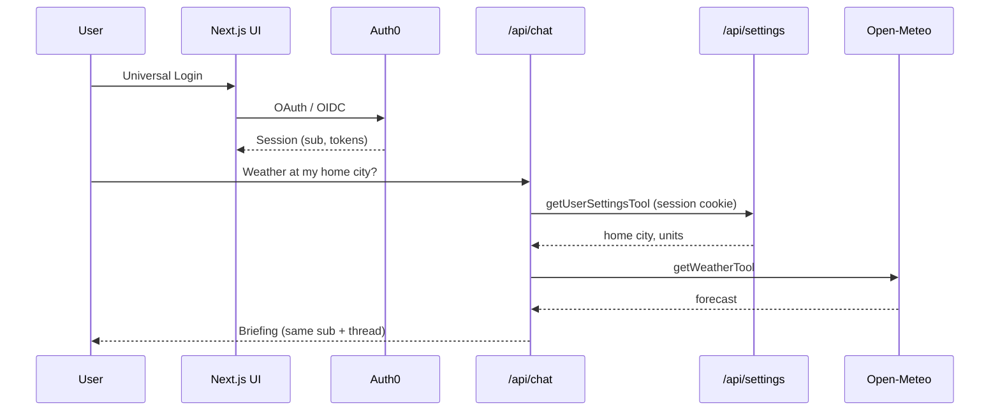

# Harbor, context-preserving personal assistant

Harbor is a signed-in chat agent that keeps **one Auth0 identity** across a conversation while calling:

1. **First-party API** — `GET` / `PATCH` `/api/settings` (home city, coordinates, units, tone, keyed by Auth0 `sub`)
2. **Third-party API** — [Open-Meteo](https://open-meteo.com/) weather for that saved location

That is the success path: **one chat turn** that cites a user setting, then fetches live weather, after Universal Login.

## Demo script

1. Sign in at [http://localhost:3000](http://localhost:3000) (**Enter with Universal Login**).
2. Open **Settings** and set home city / lat / lon / units.
3. Open **Assistant** and ask:

   > What’s the weather at my home city based on my settings?

4. The reply should mention **your city and units** and **current Open-Meteo data**. The session rail shows the same Auth0 `sub` and thread id.

## Run locally

```bash
npm install
cp .env.example .env.local
# fill Auth0 + Gemini (or OpenAI) keys
openssl rand -hex 32   # AUTH0_SECRET
npm run dev
```

App: [http://localhost:3000](http://localhost:3000)

### Auth0 URLs

Dashboard → Application → Settings. These must match `APP_BASE_URL`:

| Setting | Value |
| --- | --- |
| Allowed Callback URLs | `http://localhost:3000/auth/callback` |
| Allowed Logout URLs | `http://localhost:3000` |
| Allowed Web Origins | `http://localhost:3000` |

Mismatch error: `unauthorized_client: Callback URL mismatch`. If you must use another port, change `APP_BASE_URL` and add that callback URL in Auth0.

### Environment

| Variable | Purpose |
| --- | --- |
| `APP_BASE_URL` | Origin, e.g. `http://localhost:3000` |
| `AUTH0_DOMAIN` | Tenant domain (no `https://`) |
| `AUTH0_CLIENT_ID` / `AUTH0_CLIENT_SECRET` | Application credentials |
| `AUTH0_SECRET` | Session cookie encryption (`openssl rand -hex 32`) |
| `GOOGLE_GENERATIVE_AI_API_KEY` | Gemini tool routing (`GEMINI_API_KEY` also accepted) |
| `OPENAI_API_KEY` | GPT fallback if Gemini is unset |
| `TOKEN_VAULT_CONNECTION` | Optional, e.g. `google-oauth2` for Calendar via [Token Vault](https://auth0.com/docs/secure/call-apis-on-users-behalf/token-vault) |

Do not commit `.env.local`.

## How the agent works

- **Universal Login** — `@auth0/nextjs-auth0` session cookie. `/assistant`, `/api/chat`, and `/api/settings` require a session.
- **LLM** — With a Gemini key, chat uses **`gemini-3-flash-preview`** (`@ai-sdk/google` + Vercel AI SDK). It calls `getUserSettingsTool` then `getWeatherTool`. If both Gemini and OpenAI keys are set, Gemini wins.
- **No LLM key** — Built-in demo briefing: load settings for `sub`, call Open-Meteo, return one reply. Same APIs, no tool routing.
- **Context** — `setAIContext({ threadID })` plus the session rail (Auth0 `sub`, settings, thread).



## Stack

- Next.js 16 App Router, React 19, Tailwind 4
- `@auth0/nextjs-auth0` v4 — Universal Login and `proxy.ts`
- `ai` v6, `@ai-sdk/google`, `@ai-sdk/react` — Gemini chat and tools
- `@auth0/ai-vercel` — thread context (`setAIContext`)
